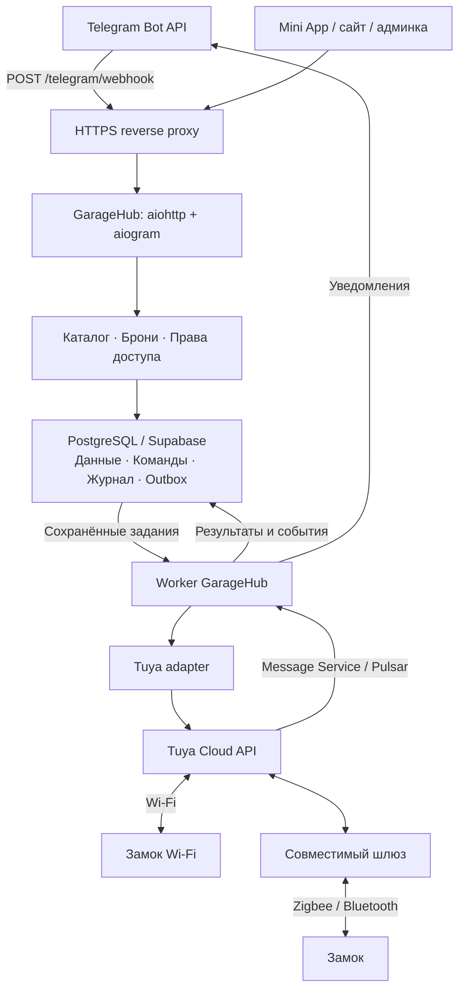
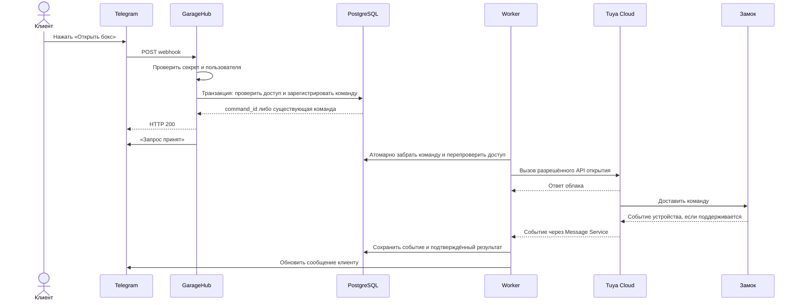

# GarageHub: системный дизайн с Telegram webhook и замками Tuya

Дата: 2 ноября 2026 года. Целевая архитектура для текущего сервиса почасовой аренды.
Основа — существующие Python 3.9, aiogram, aiohttp и Supabase/PostgreSQL.
Webhook реализован локальным коммитом `a40f688`; управление замками описано как следующий этап,
а не как уже работающая интеграция. Конкретная модель Tuya пока не определена.

## 1. Архитектурное решение

Одна кодовая база, один процесс приложения и отдельный worker. Приложение принимает
события Telegram и HTTP-запросы, проверяет пользователя и регистрирует действия.
Worker выполняет внешние операции, обрабатывает события Tuya и отправляет уведомления.
PostgreSQL хранит состояние, права и задания; подтверждённая запись в базе — граница
между принятием запроса и исполнением команды устройством.

Собственный MQTT-брокер между GarageHub и Tuya не нужен: используем облачный интерфейс
производителя. Фотографии при развитии сайта переводятся в объектное хранилище;
это отдельная задача, не часть критического пути открытия замка.

## 2. Что реализовано и что требуется добавить

| Область | Реализовано в текущей ветке | Целевое дополнение |
|---|---|---|
| Telegram | POST `/telegram/webhook`, секретный заголовок, валидация Update | Короткий обработчик регистрации команды замку |
| Повторы | Журнал `(bot_id, update_id)` в Supabase, объединение одновременных копий в одном процессе | Собственная идемпотентность каждой бизнес-команды |
| HTTP 200 | После выполнения обработчика и сохранения ID | Для открытия — после транзакции регистрации команды, до обращения к Tuya |
| Бронирование | Проверки свободного времени, четыре статуса, решение администратора | Запрет пересечений на уровне БД, транзакции подтверждения/отмены и прав доступа |
| Диалоги | MemoryStorage и SimpleEventIsolation | Пока один экземпляр приложения; постоянное состояние перед горизонтальным масштабированием |
| Оборудование | Интеграции нет | Реестр замков, права доступа, worker, Tuya adapter, события и журнал |
| Эксплуатация | Локальные логи, напоминания в процессе бота | Постоянный HTTPS, процессы под supervisor, резервные копии, метрики и оповещения |

Текущий `telegram_updates` содержит только успешно завершённые ID, без тела события.
Он не является очередью входящих событий. Ошибка после бизнес-действия, но до записи ID
оставляет окно повторного исполнения. Для замка это закрывается устойчивым ID команды
и уникальным ограничением в базе; общей гарантии exactly-once для физического устройства нет.

## 3. Ответственность компонентов

- `tgbot/`: сообщения, кнопки, идентификатор пользователя из события Telegram, короткие ответы.
- `api/`: HTTP-контракты Mini App и админки; действующая проверка Telegram initData сохраняется.
- `core/`: каталог, бронирование, правила доступа, транзакционная регистрация команд.
- Worker: отправка команд, сверка неопределённых результатов, уведомления и таймеры.
- Tuya adapter: авторизация в Tuya, выбор совместимого метода открытия, нормализация ответов и событий.
- PostgreSQL: источник истины для брони, разрешения, команды и аудита.

Бот и API вызывают одну функцию регистрации открытия. Клиент передаёт бронь и идентификатор
действия; соответствующий замок сервер находит сам. Ключи Tuya не передаются в Telegram,
JavaScript, callback_data или ответы API.

## 4. Бронь и право доступа

Пользователь ищет объект, выбирает дату и часы, отправляет заявку. Администратор
подтверждает её после согласования. При текущей оплате на месте подтверждения достаточно
для выдачи права на будущий интервал; при добавлении предоплаты правило дополняется её проверкой.

В одной транзакции подтверждаются бронь, создаётся `access_grant` и записывается задание
уведомить клиента. Отмена в одной транзакции меняет статус, отзывает grant и отменяет ещё
не отправленные команды. Отдельные REST-запросы к Supabase такой атомарности не обеспечивают:
операции реализуются серверными PostgreSQL-функциями через RPC либо прямой транзакцией.
[Функции PostgreSQL в Supabase](https://supabase.com/docs/guides/database/functions).

Пересечения активных броней одного объекта запрещаются ограничением БД на интервал
`[start_time, end_time)`. Соседние брони 12–13 и 13–14 допустимы. Применяется exclusion constraint
для `garage_id` и `tstzrange`, с условием по блокирующим статусам. Проверка в интерфейсе
остаётся для удобства, но решение о конфликте принимает база.
[Ограничения диапазонов PostgreSQL](https://www.postgresql.org/docs/current/rangetypes.html#RANGETYPES-CONSTRAINT).

`access_grant` содержит пользователя, бронь, замок, начало/конец действия и признак отзыва.
Каждое открытие проверяет grant и актуальное состояние брони. Время берётся на сервере;
в базе — timestamptz, пользователю показывается Europe/Moscow. Ранний вход по умолчанию
не разрешён; будущий допуск должен учитывать соседние брони.

Подтверждённая бронь на завтра не открывает дверь сегодня. Отмена и окончание аренды
прекращают новые открытия. Они не запускают движение ворот и не запирают человека внутри.

## 5. Сценарий открытия

Обработчик открытия не ожидает завершения операции Tuya. HTTP 200 означает, что команда
надёжно зарегистрирована. Если транзакция не завершилась, ответ — 5xx; Telegram может
повторить доставку. Секрет проверяется до доступа к базе; дубликат возвращает прежний результат.
[Контракт Telegram webhook](https://core.telegram.org/bots/api#setwebhook).

У кнопки есть серверный идентификатор действия, связанный с пользователем, бронью и сроком.
Повторные клики этой кнопки возвращают одну команду даже при разных `update_id`.
В Mini App ту же роль выполняет Idempotency-Key, связанный на сервере с пользователем
и содержимым запроса. Повтор ключа с другим содержимым отклоняется.
Для повторного входа во время аренды выдаётся новое действие после завершения предыдущего
и ограничения частоты. Один бессрочный запрет на все последующие открытия не применяется.

## 6. Исполнение и очередь команд

`lock_commands` сама является устойчивой очередью открытия: для отправки не требуется
отдельная дублирующая запись того же задания. Уведомления используют `notification_outbox`,
записываемый в транзакции с изменением бизнес-состояния.

Worker атомарно забирает подходящую команду, фиксирует `dispatching` и освобождает
транзакцию до HTTP-запроса к Tuya. Захват реализуется RPC/транзакцией с блокировкой строки,
при нескольких потребителях — `FOR UPDATE SKIP LOCKED`. Долгая транзакция на время сети
не удерживается. В один момент на один замок разрешена одна неразрешённая операция.
[Захват очереди в PostgreSQL](https://www.postgresql.org/docs/current/sql-select.html#SQL-FOR-UPDATE-SHARE).

При прямом подключении к PostgreSQL worker пробуждается через LISTEN/NOTIFY. Уведомление —
только сигнал перечитать таблицу: состояние в нём не хранится. После запуска, переподключения
и по периодическому таймеру выполняется сверка очереди, сроков и зависших команд.
Для LISTEN нужно постоянное соединение; существующего HTTP-клиента Supabase недостаточно.
Если на первом этапе доступен только PostgREST, допустим ограниченный опрос таблицы через RPC
с паузой и backoff. Это явно внутренний механизм очереди, не polling Telegram или каждого замка.
[Семантика NOTIFY](https://www.postgresql.org/docs/current/sql-notify.html).

Перед отправкой повторно проверяются grant, его версия, сроки команды и доступность устройства.
Отмена может предотвратить ещё не отправленный запрос. Уже отправленный внешний запрос
нельзя считать отменённым до подтверждения от провайдера; гонка отмены с отправкой фиксируется в аудите.

## 7. Состояния команд и достоверность результата

| Состояние | Значение и дальнейшее действие |
|---|---|
| `queued` | Записана, ещё не отправлялась; может истечь или быть отменена |
| `dispatching` | Worker начал отправку; после аварии нельзя автоматически предполагать, что отправки не было |
| `cloud_accepted` | Облако приняло запрос; физическая разблокировка ещё не доказана |
| `device_confirmed` | Есть достоверное подтверждение устройства для этой операции |
| `failed` | Получен определённый отказ |
| `expired` | Срок истёк до отправки |
| `cancelled` | Отменена до отправки |
| `unknown` | Команда могла выполниться; требуется сверка, а не слепой повтор |

Таймаут после возможной отправки и потеря worker в `dispatching` переводят операцию
в сверку результата. Без подтверждённой идемпотентности Tuya повторная физическая отправка
автоматически не выполняется. Новая команда этому замку блокируется до разрешения
неопределённости либо отдельного явно зафиксированного решения администратора.

Срок хранения и срок исполнения команды различаются. `expires_at` ограничивает нашу очередь;
срок действия уже переданной команды определяется возможностями устройства и Tuya.
Ограничить его гарантированно можно только при поддержке конечной стороной. Это проверяется на пилоте.

Получение статуса unlocked не всегда позволяет связать событие с определённой командой.
Adapter хранит исходный event ID, время события/получения и доступную корреляцию. При отсутствии
надёжной корреляции обновляется состояние устройства, но команда не объявляется доказанно исполненной.
Старые события не перезаписывают более свежее состояние; повторы событий не создают новые действия.

Сообщения разделяются: «запрос зарегистрирован», «команда принята облаком»,
«замок разблокирован». «Дверь открыта» показывается только по датчику положения двери.
Историческое состояние всегда имеет отметку времени и не выдаётся за актуальное при потере связи.

## 8. Интеграция Tuya и оборудование

Выбирается конкретная модель с разрешённым Cloud API и дистанционной доступностью без
предварительного действия человека у двери. Для Bluetooth/Zigbee проверяется совместимый шлюз.
Устройство добавляется в авторизованный cloud project; фиксируются регион и доступные функции.

Adapter получает временный ticket и вызывает поддерживаемую данной моделью операцию открытия.
Например, документация описывает `/v1.0/smart-lock/devices/{device_id}/password-ticket`
и `/v1.0/smart-lock/devices/{device_id}/password-free/door-operate`, но совместимость и
требуемые функции устройства нужно подтвердить. Универсальный API для любого Tuya-замка
не предполагается. [Tuya Remote Unlocking APIs](https://developer.tuya.com/en/docs/cloud/doorlock-api-remoteopen?id=Kbe2nm6j9hcsj).

События принимаются через Tuya Message Service/Pulsar с consumer SDK. Consumer подтверждает
приём после сохранения события и соответствующих изменений в базе. Это не произвольный
публичный webhook Tuya, существование которого можно предположить без настройки сервиса.
[Tuya Message Service](https://developer.tuya.com/en/docs/iot/pulsar-msg-optimization?id=Kfne1xuv88hs2).

Пилот подтверждает доступность открытия, задержку, поведение при пропадании сети,
разряде батареи и перезагрузке шлюза. Также проверяются события, их корреляция и возможное
позднее исполнение команды после восстановления связи. Замок, не позволяющий обеспечить
принятую политику исполнения, не допускается к автоматическому открытию в этой конфигурации.

## 9. Модель данных

| Сущность | Основные данные и ограничения |
|---|---|
| `garages` | Текущий каталог, режим работы, цена и состояние публикации |
| `bookings` | Клиент, объект, интервал, сумма и статус; запрет пересечений активных интервалов |
| `owner_requests` | Существующие обращения владельцев |
| `telegram_updates` | Уже реализованный журнал завершённых Update по `(bot_id, update_id)` |
| `lock_devices` | Объект, provider device ID, ссылка на серверное подключение Tuya, возможности, состояние и его время |
| `access_grants` | Клиент, бронь, замок, интервал, версия и отзыв права |
| `lock_commands` | UUID, источник/ключ идемпотентности, клиент, grant, замок, сроки, состояние, попытки и результат |
| `device_events` | Provider event ID, устройство, время события/получения, нормализованный тип, корреляция |
| `notification_outbox` | Получатель, бизнес-событие, payload, состояние отправки и следующая попытка |
| `audit_log` | Кто, когда, по какой причине запросил доступ, изменил право или принял ручное решение |

Ключ команды уникален в контексте пользователя и действия. Привязка устройства не меняется
во время исполнения команды без процедуры вывода устройства из обслуживания.
Если один объект содержит несколько независимо арендуемых боксов, перед запуском он
разделяется на отдельные ресурсы бронирования: один общий `garage_id` не моделирует их вместимость.

Транзакции и ограничения обязательны для команд и прав независимо от дедупликации транспорта.
Сроки хранения аудита и персональных данных задаются отдельно; секреты, PIN и временные ticket
не записываются в обычные логи и доступный клиенту журнал.

## 10. Контракты API

| Интерфейс | Статус и назначение |
|---|---|
| POST `/telegram/webhook` | Реализован: секрет Telegram вместо пользовательского initData |
| GET `/api/garages`, `/api/garages/{id}`, `/availability` | Существующий открытый каталог |
| POST `/api/bookings`, GET `/api/bookings`, отмена | Существующие операции; транзакционное усиление планируется |
| POST `/api/bookings/{id}/unlock` | Новый: Telegram-пользователь, Idempotency-Key; ответ 202 с command_id |
| GET `/api/lock-commands/{id}` | Новый: состояние команды только её владельцу или уполномоченному администратору |
| GET `/api/admin/locks` | Новый: устройства, возможности, состояние связи и батарея, если поддерживается |
| POST `/api/admin/locks/{id}/unlock` | Новый: отдельное право оператора, обязательная причина, аудит и та же очередь |

Callback бота и endpoint Mini App используют общий сервис регистрации команды. Роль
владельца площадки не даёт доступа к чужим объектам. Ручной доступ оператора разрешается
явно и не подменяется клиентской бронью.

## 11. Развёртывание и восстановление

Начальная production-топология: постоянный домен и HTTPS reverse proxy, один экземпляр
приложения, один worker, PostgreSQL/Supabase с резервными копиями. Процессы запускаются
через systemd или контейнерный supervisor. Временный меняющийся туннель остаётся средством разработки.

Сохраняется текущая настройка `TELEGRAM_WEBHOOK_URL` и `TELEGRAM_WEBHOOK_SECRET`.
Webhook регистрируется после запуска HTTP, при остановке не удаляется. Переключение
в polling требует остановки webhook-экземпляра; два режима одного бота одновременно не запускаются.
`MINIAPP_DEV` в production выключен. Заголовок секрета проходит через reverse proxy.

Команды критического пути и постановка уведомлений выполняются до ответа о принятии.
Уведомление о результате может задержаться при проблемах Telegram; это не запускает
повтор открытия. Исходящие сообщения допускают возможный повтор при аварии после отправки,
но до отметки в outbox; физическая команда от уведомления не зависит.

Контролируются ошибки webhook, задержка ответа, возраст очереди, зависшие/неопределённые
команды, ошибки Tuya, состояние соединения consumer, устаревшая телеметрия и доставка уведомлений.
Readiness проверяет доступность БД, а не только текущий статический `/api/health`.
Отказ Tuya ухудшает доступ к замкам, но не должен делать каталог недоступным.

После восстановления базы из резервной копии отправка команд запускается только после
сверки: старые `dispatching` не переисполняются автоматически, просроченные `queued`
не отправляются. Аварийный вход через ответственного оператора и локальный выход
из бокса предусмотрены независимо от Telegram и облака.

Горизонтальное масштабирование начинается после переноса FSM и координации из памяти,
проверки порядка событий одного пользователя и межпроцессного захвата команд. До этого
несколько веб-процессов с одним ботом не поддерживаются. Число workers увеличивается
с сохранением ограничения одной неразрешённой операции на устройство.

## 12. Проверка готовности и порядок реализации

1. Применить webhook-изменения, миграцию 002 и проверить постоянный HTTPS на тестовом боте.
2. Провести пилот конкретного Tuya-замка; подтвердить управление, события и поведение после сбоев.
3. Ввести транзакции бронирования/прав и ограничение пересечений; добавить миграции сущностей доступа.
4. Реализовать устойчивые команды, worker и adapter; подключить кнопку бота и API Mini App.
5. Добавить consumer событий, сверку unknown, outbox, интерфейс оператора и мониторинг.
6. Проверить на одном боксе, затем расширять подключение оборудования.

Приёмочные сценарии: два клиента одновременно бронируют один интервал; два одинаковых
webhook; повтор клика с новым Update; чужая или истёкшая бронь; отмена до/во время отправки;
перезапуск до и после вызова Tuya; таймаут с неизвестным исходом; повтор/опоздание события;
потеря сети и питания; восстановление базы; невозможность уведомить клиента после исполнения.
Ни один из этих сбоев не должен сам по себе порождать новую неконтролируемую команду открытия.

В ветке уже есть 21 автономный тест webhook и 8 проверок дат. Тесты физического доступа,
нагрузка, миграции доступа и испытания оборудования относятся к перечисленным следующим этапам.
