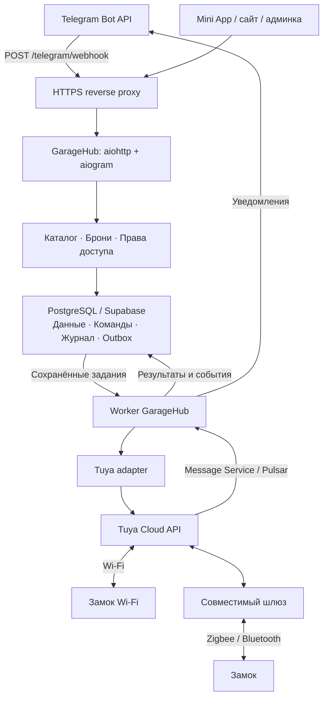
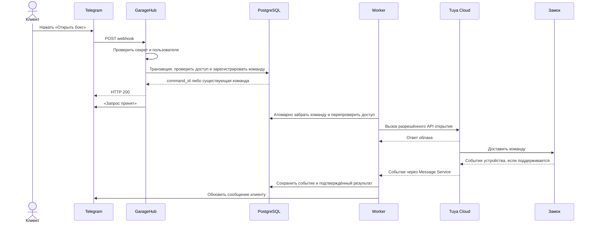

# GarageHub: системный дизайн с Telegram webhook и замками Tuya

## TL;DR — как это будет работать

Клиент открывает GarageHub в Telegram, выбирает гараж, день и часы и отправляет заявку.
Администратор подтверждает её. В назначенное время клиент нажимает **«Открыть бокс»**:
сервис проверяет, что это его бронь и время входа уже наступило, и отправляет команду
замку Tuya. Оплата в первой версии остаётся на месте.

Клиент видит результат открытия. Если замок не отвечает или результат неизвестен,
сервис сообщает об этом и уведомляет администратора. Повторный клик не должен создавать
несколько одинаковых команд. После отмены или окончания брони новый вход недоступен,
а выйти из бокса можно независимо от связи с интернетом.

Администратор управляет боксами, заявками и доступом, видит проблемы с замками и помогает
при сбоях. Сервис постоянно работает на сервере — держать личный компьютер включённым
не потребуется. **Бот, каталог и бронирование уже есть; дистанционное открытие замков
и постоянную работу на сервере ещё предстоит довести до готовности.**

Дата: 2 ноября 2026 года. Ниже описана целевая архитектура первой рабочей версии.
Основа — существующие Python 3.9, aiogram, aiohttp и Supabase/PostgreSQL.
Webhook реализован в [PR №1](https://github.com/yahtanik1-arch/garage-hub/pull/1);
управление замками описано как следующий этап, а не как уже работающая интеграция.
Конкретная модель Tuya пока не определена. Порядок работ — в разделе «Задачи»,
граница готовности — в DoD, плановые даты — в разделе «Дедлайн».

## 1. Архитектурное решение

Одна кодовая база, один процесс приложения и отдельный worker. Приложение принимает
события Telegram и HTTP-запросы, проверяет пользователя и регистрирует действия.
Worker выполняет внешние операции, обрабатывает события Tuya и отправляет уведомления.
PostgreSQL хранит состояние, права и задания; подтверждённая запись в базе — граница
между принятием запроса и исполнением команды устройством.

Собственный MQTT-брокер между GarageHub и Tuya не нужен: используем облачный интерфейс
производителя. Фотографии при развитии сайта переводятся в объектное хранилище;
это отдельная задача, не часть критического пути открытия замка.

## 2. Что реализовано и что требуется добавить

| Область | Реализовано в текущей ветке | Целевое дополнение |
|---|---|---|
| Telegram | POST `/telegram/webhook`, секретный заголовок, валидация Update | Короткий обработчик регистрации команды замку |
| Повторы | Журнал `(bot_id, update_id)` в Supabase, объединение одновременных копий в одном процессе | Собственная идемпотентность каждой бизнес-команды |
| HTTP 200 | После выполнения обработчика и сохранения ID | Для открытия — после транзакции регистрации команды, до обращения к Tuya |
| Бронирование | Проверки свободного времени, четыре статуса, решение администратора | Запрет пересечений на уровне БД, транзакции подтверждения/отмены и прав доступа |
| Диалоги | MemoryStorage и SimpleEventIsolation | Пока один экземпляр приложения; постоянное состояние перед горизонтальным масштабированием |
| Оборудование | Интеграции нет | Реестр замков, права доступа, worker, Tuya adapter, события и журнал |
| Эксплуатация | Локальные логи, напоминания в процессе бота | Постоянный HTTPS, процессы под supervisor, резервные копии, метрики и оповещения |

Текущий `telegram_updates` содержит только успешно завершённые ID, без тела события.
Он не является очередью входящих событий. Ошибка после бизнес-действия, но до записи ID
оставляет окно повторного исполнения. Для замка это закрывается устойчивым ID команды
и уникальным ограничением в базе; общей гарантии exactly-once для физического устройства нет.

## 3. Ответственность компонентов

- `tgbot/`: сообщения, кнопки, идентификатор пользователя из события Telegram, короткие ответы.
- `api/`: HTTP-контракты Mini App и админки; действующая проверка Telegram initData сохраняется.
- `core/`: каталог, бронирование, правила доступа, транзакционная регистрация команд.
- Worker: отправка команд, сверка неопределённых результатов, уведомления и таймеры.
- Tuya adapter: авторизация в Tuya, выбор совместимого метода открытия, нормализация ответов и событий.
- PostgreSQL: источник истины для брони, разрешения, команды и аудита.

Бот и API вызывают одну функцию регистрации открытия. Клиент передаёт бронь и идентификатор
действия; соответствующий замок сервер находит сам. Ключи Tuya не передаются в Telegram,
JavaScript, callback_data или ответы API.

## 4. Бронь и право доступа

Пользователь ищет объект, выбирает дату и часы, отправляет заявку. Администратор
подтверждает её после согласования. При текущей оплате на месте подтверждения достаточно
для выдачи права на будущий интервал; при добавлении предоплаты правило дополняется её проверкой.

В одной транзакции подтверждаются бронь, создаётся `access_grant` и записывается задание
уведомить клиента. Отмена в одной транзакции меняет статус, отзывает grant и отменяет ещё
не отправленные команды. Отдельные REST-запросы к Supabase такой атомарности не обеспечивают:
операции реализуются серверными PostgreSQL-функциями через RPC либо прямой транзакцией.
[Функции PostgreSQL в Supabase](https://supabase.com/docs/guides/database/functions).

Пересечения активных броней одного объекта запрещаются ограничением БД на интервал
`[start_time, end_time)`. Соседние брони 12–13 и 13–14 допустимы. Применяется exclusion constraint
для `garage_id` и `tstzrange`, с условием по блокирующим статусам. Проверка в интерфейсе
остаётся для удобства, но решение о конфликте принимает база.
[Ограничения диапазонов PostgreSQL](https://www.postgresql.org/docs/current/rangetypes.html#RANGETYPES-CONSTRAINT).

`access_grant` содержит пользователя, бронь, замок, начало/конец действия и признак отзыва.
Каждое открытие проверяет grant и актуальное состояние брони. Время берётся на сервере;
в базе — timestamptz, пользователю показывается Europe/Moscow. Ранний вход по умолчанию
не разрешён; будущий допуск должен учитывать соседние брони.

Подтверждённая бронь на завтра не открывает дверь сегодня. Отмена и окончание аренды
прекращают новые открытия. Они не запускают движение ворот и не запирают человека внутри.

## 5. Сценарий открытия

Обработчик открытия не ожидает завершения операции Tuya. HTTP 200 означает, что команда
надёжно зарегистрирована. Если транзакция не завершилась, ответ — 5xx; Telegram может
повторить доставку. Секрет проверяется до доступа к базе; дубликат возвращает прежний результат.
[Контракт Telegram webhook](https://core.telegram.org/bots/api#setwebhook).

У кнопки есть серверный идентификатор действия, связанный с пользователем, бронью и сроком.
Повторные клики этой кнопки возвращают одну команду даже при разных `update_id`.
В Mini App ту же роль выполняет Idempotency-Key, связанный на сервере с пользователем
и содержимым запроса. Повтор ключа с другим содержимым отклоняется.
Для повторного входа во время аренды выдаётся новое действие после завершения предыдущего
и ограничения частоты. Один бессрочный запрет на все последующие открытия не применяется.

## 6. Исполнение и очередь команд

`lock_commands` сама является устойчивой очередью открытия: для отправки не требуется
отдельная дублирующая запись того же задания. Уведомления используют `notification_outbox`,
записываемый в транзакции с изменением бизнес-состояния.

Worker атомарно забирает подходящую команду, фиксирует `dispatching` и освобождает
транзакцию до HTTP-запроса к Tuya. Захват реализуется RPC/транзакцией с блокировкой строки,
при нескольких потребителях — `FOR UPDATE SKIP LOCKED`. Долгая транзакция на время сети
не удерживается. В один момент на один замок разрешена одна неразрешённая операция.
[Захват очереди в PostgreSQL](https://www.postgresql.org/docs/current/sql-select.html#SQL-FOR-UPDATE-SHARE).

При прямом подключении к PostgreSQL worker пробуждается через LISTEN/NOTIFY. Уведомление —
только сигнал перечитать таблицу: состояние в нём не хранится. После запуска, переподключения
и по периодическому таймеру выполняется сверка очереди, сроков и зависших команд.
Для LISTEN нужно постоянное соединение; существующего HTTP-клиента Supabase недостаточно.
Если на первом этапе доступен только PostgREST, допустим ограниченный опрос таблицы через RPC
с паузой и backoff. Это явно внутренний механизм очереди, не polling Telegram или каждого замка.
[Семантика NOTIFY](https://www.postgresql.org/docs/current/sql-notify.html).

Перед отправкой повторно проверяются grant, его версия, сроки команды и доступность устройства.
Отмена может предотвратить ещё не отправленный запрос. Уже отправленный внешний запрос
нельзя считать отменённым до подтверждения от провайдера; гонка отмены с отправкой фиксируется в аудите.

## 7. Состояния команд и достоверность результата

| Состояние | Значение и дальнейшее действие |
|---|---|
| `queued` | Записана, ещё не отправлялась; может истечь или быть отменена |
| `dispatching` | Worker начал отправку; после аварии нельзя автоматически предполагать, что отправки не было |
| `cloud_accepted` | Облако приняло запрос; физическая разблокировка ещё не доказана |
| `device_confirmed` | Есть достоверное подтверждение устройства для этой операции |
| `failed` | Получен определённый отказ |
| `expired` | Срок истёк до отправки |
| `cancelled` | Отменена до отправки |
| `unknown` | Команда могла выполниться; требуется сверка, а не слепой повтор |

Таймаут после возможной отправки и потеря worker в `dispatching` переводят операцию
в сверку результата. Без подтверждённой идемпотентности Tuya повторная физическая отправка
автоматически не выполняется. Новая команда этому замку блокируется до разрешения
неопределённости либо отдельного явно зафиксированного решения администратора.

Срок хранения и срок исполнения команды различаются. `expires_at` ограничивает нашу очередь;
срок действия уже переданной команды определяется возможностями устройства и Tuya.
Ограничить его гарантированно можно только при поддержке конечной стороной. Это проверяется на пилоте.

Получение статуса unlocked не всегда позволяет связать событие с определённой командой.
Adapter хранит исходный event ID, время события/получения и доступную корреляцию. При отсутствии
надёжной корреляции обновляется состояние устройства, но команда не объявляется доказанно исполненной.
Старые события не перезаписывают более свежее состояние; повторы событий не создают новые действия.

Сообщения разделяются: «запрос зарегистрирован», «команда принята облаком»,
«замок разблокирован». «Дверь открыта» показывается только по датчику положения двери.
Историческое состояние всегда имеет отметку времени и не выдаётся за актуальное при потере связи.

## 8. Интеграция Tuya и оборудование

Выбирается конкретная модель с разрешённым Cloud API и дистанционной доступностью без
предварительного действия человека у двери. Для Bluetooth/Zigbee проверяется совместимый шлюз.
Устройство добавляется в авторизованный cloud project; фиксируются регион и доступные функции.

Adapter получает временный ticket и вызывает поддерживаемую данной моделью операцию открытия.
Например, документация описывает `/v1.0/smart-lock/devices/{device_id}/password-ticket`
и `/v1.0/smart-lock/devices/{device_id}/password-free/door-operate`, но совместимость и
требуемые функции устройства нужно подтвердить. Универсальный API для любого Tuya-замка
не предполагается. [Tuya Remote Unlocking APIs](https://developer.tuya.com/en/docs/cloud/doorlock-api-remoteopen?id=Kbe2nm6j9hcsj).

События принимаются через Tuya Message Service/Pulsar с consumer SDK. Consumer подтверждает
приём после сохранения события и соответствующих изменений в базе. Это не произвольный
публичный webhook Tuya, существование которого можно предположить без настройки сервиса.
[Tuya Message Service](https://developer.tuya.com/en/docs/iot/pulsar-msg-optimization?id=Kfne1xuv88hs2).

Пилот подтверждает доступность открытия, задержку, поведение при пропадании сети,
разряде батареи и перезагрузке шлюза. Также проверяются события, их корреляция и возможное
позднее исполнение команды после восстановления связи. Замок, не позволяющий обеспечить
принятую политику исполнения, не допускается к автоматическому открытию в этой конфигурации.

## 9. Модель данных

| Сущность | Основные данные и ограничения |
|---|---|
| `garages` | Текущий каталог, режим работы, цена и состояние публикации |
| `bookings` | Клиент, объект, интервал, сумма и статус; запрет пересечений активных интервалов |
| `owner_requests` | Существующие обращения владельцев |
| `telegram_updates` | Уже реализованный журнал завершённых Update по `(bot_id, update_id)` |
| `lock_devices` | Объект, provider device ID, ссылка на серверное подключение Tuya, возможности, состояние и его время |
| `access_grants` | Клиент, бронь, замок, интервал, версия и отзыв права |
| `lock_commands` | UUID, источник/ключ идемпотентности, клиент, grant, замок, сроки, состояние, попытки и результат |
| `device_events` | Provider event ID, устройство, время события/получения, нормализованный тип, корреляция |
| `notification_outbox` | Получатель, бизнес-событие, payload, состояние отправки и следующая попытка |
| `audit_log` | Кто, когда, по какой причине запросил доступ, изменил право или принял ручное решение |

Ключ команды уникален в контексте пользователя и действия. Привязка устройства не меняется
во время исполнения команды без процедуры вывода устройства из обслуживания.
Если один объект содержит несколько независимо арендуемых боксов, перед запуском он
разделяется на отдельные ресурсы бронирования: один общий `garage_id` не моделирует их вместимость.

Транзакции и ограничения обязательны для команд и прав независимо от дедупликации транспорта.
Сроки хранения аудита и персональных данных задаются отдельно; секреты, PIN и временные ticket
не записываются в обычные логи и доступный клиенту журнал.

## 10. Контракты API

| Интерфейс | Статус и назначение |
|---|---|
| POST `/telegram/webhook` | Реализован: секрет Telegram вместо пользовательского initData |
| GET `/api/garages`, `/api/garages/{id}`, `/availability` | Существующий открытый каталог |
| POST `/api/bookings`, GET `/api/bookings`, отмена | Существующие операции; транзакционное усиление планируется |
| POST `/api/bookings/{id}/unlock` | Новый: Telegram-пользователь, Idempotency-Key; ответ 202 с command_id |
| GET `/api/lock-commands/{id}` | Новый: состояние команды только её владельцу или уполномоченному администратору |
| GET `/api/admin/locks` | Новый: устройства, возможности, состояние связи и батарея, если поддерживается |
| POST `/api/admin/locks/{id}/unlock` | Новый: отдельное право оператора, обязательная причина, аудит и та же очередь |

Callback бота и endpoint Mini App используют общий сервис регистрации команды. Роль
владельца площадки не даёт доступа к чужим объектам. Ручной доступ оператора разрешается
явно и не подменяется клиентской бронью.

## 11. Развёртывание и восстановление

Начальная production-топология: постоянный домен и HTTPS reverse proxy, один экземпляр
приложения, один worker, PostgreSQL/Supabase с резервными копиями. Процессы запускаются
через systemd или контейнерный supervisor. Временный меняющийся туннель остаётся средством разработки.

Сохраняется текущая настройка `TELEGRAM_WEBHOOK_URL` и `TELEGRAM_WEBHOOK_SECRET`.
Webhook регистрируется после запуска HTTP, при остановке не удаляется. Переключение
в polling требует остановки webhook-экземпляра; два режима одного бота одновременно не запускаются.
`MINIAPP_DEV` в production выключен. Заголовок секрета проходит через reverse proxy.

Команды критического пути и постановка уведомлений выполняются до ответа о принятии.
Уведомление о результате может задержаться при проблемах Telegram; это не запускает
повтор открытия. Исходящие сообщения допускают возможный повтор при аварии после отправки,
но до отметки в outbox; физическая команда от уведомления не зависит.

Контролируются ошибки webhook, задержка ответа, возраст очереди, зависшие/неопределённые
команды, ошибки Tuya, состояние соединения consumer, устаревшая телеметрия и доставка уведомлений.
Readiness проверяет доступность БД, а не только текущий статический `/api/health`.
Отказ Tuya ухудшает доступ к замкам, но не должен делать каталог недоступным.

После восстановления базы из резервной копии отправка команд запускается только после
сверки: старые `dispatching` не переисполняются автоматически, просроченные `queued`
не отправляются. Аварийный вход через ответственного оператора и локальный выход
из бокса предусмотрены независимо от Telegram и облака.

Горизонтальное масштабирование начинается после переноса FSM и координации из памяти,
проверки порядка событий одного пользователя и межпроцессного захвата команд. До этого
несколько веб-процессов с одним ботом не поддерживаются. Число workers увеличивается
с сохранением ограничения одной неразрешённой операции на устройство.

## 12. Задачи

Объём — GarageHub v1.0: действующий каталог, заявки с подтверждением администратора,
Mini App, оплата на месте и открытие подключённого Tuya-замка через Telegram.
Задачи выполняются сверху вниз. Каждая закрывается отдельным проверяемым изменением:
код/настройка, необходимые проверки и короткая запись результата в PR.

Исполнитель разработки и автоматических проверок — **GPT‑6.1 Sol**. Владелец предоставляет
доступы, подключает оборудование и обеспечивает человека у бокса для физических испытаний.
Уже сделанный webhook заново не переписываем. Если оборудование для T03 задерживается,
задачи T04–T22 можно выполнять с имитатором Tuya; T23–T25 остаются обязательными.

- [ ] **T01. Подготовить тестовое окружение и доступы.** Выделить тестового бота,
  изолированную базу, сервер/домен и проект Tuya; зафиксировать модель замка и шлюз.
  **Готово:** модель может запустить тесты, подключиться к тестовой базе и авторизоваться
  в Tuya, не затрагивая реальных клиентов; секреты находятся вне репозитория.

- [ ] **T02. Проверить существующий webhook на сервере.** Применить миграцию 002
  в тестовой базе, настроить постоянный HTTPS и секрет, проверить запуск и остановку.
  **Готово:** сообщение и callback доходят до бота, неверный секрет отклоняется,
  повтор события не выполняет завершённый обработчик заново, после перезапуска приём восстанавливается.

- [ ] **T03. Подтвердить совместимость одного замка Tuya.** Проверить на тестовом
  устройстве удалённое открытие через официальный API, нужный шлюз и доступные события.
  **Готово:** записаны рабочий метод, функции модели и результат физического открытия;
  понятно, как подтверждать исполнение и что происходит при потере связи.

- [ ] **T04. Добавить реестр устройств и привязку к боксам.** Ввести `lock_devices`,
  признаки доступных функций, состояние с отметкой времени и проверку назначения устройства.
  **Готово:** у арендуемого ресурса определён правильный замок; чужое или не назначенное
  устройство нельзя выбрать через клиентский запрос.

- [ ] **T05. Запретить двойное бронирование в базе.** Добавить ограничение пересечений
  активных интервалов и понятный ответ о конфликте.
  **Готово:** из двух одновременных заявок на один интервал проходит только одна,
  а соседние интервалы без пересечения сохраняются.

- [ ] **T06. Добавить права доступа и журнал действий.** Ввести `access_grants`
  с интервалом/версией/отзывом и `audit_log` для решений по доступу.
  **Готово:** проверка права учитывает пользователя, бронь, устройство, время и отзыв;
  выдача и отзыв оставляют запись об инициаторе и причине.

- [ ] **T07. Сделать подтверждение брони одной транзакцией.** Объединить смену статуса,
  создание права доступа и задание уведомить клиента; добавить схему `notification_outbox`.
  **Готово:** сохраняются все три изменения либо ни одно; повтор подтверждения
  не выдаёт второе право и не создаёт второе задание того же бизнес-события.

- [ ] **T08. Связать отмену брони с отзывом доступа.** Сделать отмену и отзыв одной
  транзакцией; закрыть регистрацию новых открытий по отменённой/завершившейся брони.
  **Готово:** старая кнопка больше не даёт доступ; пользователь получает понятный отказ.
  Отмена ещё не отправленных команд будет подключена в T10.

- [ ] **T09. Добавить устойчивую модель команды замку.** Ввести `lock_commands`,
  идентификатор действия, сроки, состояния и ограничение одной неразрешённой операции на устройство.
  **Готово:** база запрещает повтор одного действия, а `unknown` отличим от явного отказа.

- [ ] **T10. Реализовать общий сервис регистрации открытия.** Проверять право,
  регистрировать команду транзакционно, возвращать прежнюю команду при повторе;
  при отзыве права отменять ещё не отправленные команды.
  **Готово:** повтор клика с новым `update_id` не создаёт второе открытие,
  чужая бронь отклоняется, отмена освобождает только безопасно отменяемые команды.

- [ ] **T11. Реализовать Tuya adapter.** Добавить серверную авторизацию/обновление
  токена, получение ticket и выбранный в T03 метод открытия; нормализовать ответы.
  **Готово:** запрос выполняется на тестовом устройстве либо имитаторе, ошибки различимы,
  токены и ticket не попадают в сообщения клиенту и логи.

- [ ] **T12. Добавить worker и атомарный захват задания.** Создать отдельную точку
  запуска, выбор готовых команд и устойчивое состояние захвата; подключить пробуждение
  и восстановительную сверку очереди по разделу 6.
  **Готово:** два исполнителя не забирают одну команду, перезапуск не теряет `queued`,
  а долгая операция Tuya не удерживает транзакцию базы.

- [ ] **T13. Подключить отправку с проверкой сроков.** Перед вызовом Tuya перепроверять
  право, версию и сроки; сохранять результат отправки и разграничивать безопасный повтор и `unknown`.
  **Готово:** просроченное задание не отправляется; таймаут после возможной отправки
  и авария в `dispatching` не приводят к автоматическому повторному открытию.

- [ ] **T14. Принимать события Tuya.** Подключить Message Service, сохранять
  `device_events`, удалять повторы и обновлять телеметрию по времени события.
  **Готово:** событие подтверждается провайдеру после записи, дубликат не создаёт
  второе действие, старое событие не затирает более новое состояние.

- [ ] **T15. Сверять результат открытия.** Связывать команду с подтверждением,
  где это позволяет модель; обрабатывать отсутствие/опоздание подтверждения и ручное разрешение `unknown`.
  **Готово:** ответ облака не выдаётся за физическое открытие; неоднозначность видна
  оператору, а возобновление отправки требует подтверждённого результата или отдельного решения.

- [ ] **T16. Добавить отправку уведомлений из outbox.** Доставлять подтверждения,
  результаты открытия и ошибки с контролируемыми повторными попытками.
  **Готово:** недоступный Telegram не откатывает бронь и не повторяет команду замку;
  неотправленные уведомления сохраняются после перезапуска.

- [ ] **T17. Добавить кнопку открытия в бот.** Выдавать ограниченный по времени
  идентификатор действия, быстро подтверждать получение клика и обновлять результат.
  **Готово:** действующая бронь открывает свой бокс через общий сервис; повтор клика
  показывает текущую команду; после её завершения можно получить новое действие для повторного входа.

- [ ] **T18. Добавить открытие в API и Mini App.** Реализовать POST открытия,
  GET состояния команды и кнопку в своей брони с понятными состояниями ожидания/ошибки.
  **Готово:** работает тот же сервис, что в боте; чужие команды недоступны,
  Idempotency-Key защищает повтор, а прежние поиск и бронирование проходят регрессионные проверки.

- [ ] **T19. Добавить управление замками администратору.** Показать назначение,
  свежесть состояния, проблемы и команды; добавить ручное открытие с причиной и отдельным правом.
  **Готово:** оператор видит проблему и может принять записанное в аудите решение;
  обычный клиент и владелец чужого объекта не получают административный доступ.

- [ ] **T20. Подготовить постоянный запуск приложения и worker.** Добавить конфигурацию
  процессов, автоматический перезапуск и readiness с проверкой базы.
  **Готово:** сервис запускается без личного компьютера, после перезагрузки сервера
  восстанавливается, а выключенный Tuya не останавливает публичный каталог.

- [ ] **T21. Настроить наблюдение и инструкцию оператора.** Контролировать возраст
  очереди, `unknown`, ошибки Tuya, связь consumer и свежесть телеметрии;
  описать резервные копии, остановку отправки и помощь клиенту.
  **Готово:** искусственный сбой вызывает проверяемое оповещение, по инструкции
  можно определить бронь, устройство и команду без доступа к секретам.

- [ ] **T22. Прогнать автоматические проверки отказов и конкуренции.** Проверить
  дубликаты, истёкшие права, отмену при отправке, ошибки базы, таймауты, перезапуск
  и одновременные обращения; выполнить существующие тесты API и бота на изолированной базе.
  **Готово:** проверки проходят, права не обходятся, одна логическая операция
  не создаёт несколько команд; границы недоказуемого результата отражены в тестах.

- [ ] **T23. Провести приёмку на одном реальном боксе.** Пройти путь от поиска
  до открытия, затем проверить потерю сети/питания, шлюз и задержанные события
  с человеком на месте; подтвердить локальный выход и резервный порядок доступа.
  **Готово:** есть протокол результатов; при восстановлении связи старое действие
  не вызывает неконтролируемое открытие, администратор получает сведения о проблеме.

- [ ] **T24. Проверить восстановление и подготовить выпуск.** На тестовой базе
  восстановить резервную копию, выполнить сверку команд, проверить миграции и откат;
  зафиксировать конфигурацию/версии и инструкцию подключения следующего бокса.
  **Готово:** старые команды не отправляются автоматически после восстановления,
  повторный запуск по инструкции воспроизводим и код готов к выпуску.

- [ ] **T25. Завершить суточный пилот и принять v1.0.** Наблюдать за первым боксом
  24 часа после приёмки, разобрать ошибки и сверить все пункты DoD.
  **Готово:** нет неразобранных критических сбоев и нарушений прав доступа;
  владелец принимает результат по протоколу, а не только по успешному запуску программы.

## 13. DoD — когда проект готов

**GarageHub v1.0 готов к приёму реальных клиентов на подключённых площадках**, когда
закрыты T01–T25 и одновременно выполнены все условия ниже. Готовый код без испытания
физического доступа считается завершением разработки, но не готовностью всего сервиса.

- [ ] Клиент может найти бокс, оформить заявку, получить подтверждение,
  увидеть свою бронь, открыть назначенный бокс в разрешённое время и повторно войти в период аренды.
- [ ] Администратор может управлять объектами, подтверждать/отклонять заявки,
  обрабатывать обращения владельцев, видеть проблемы замков и выполнять разрешённые ручные действия.
- [ ] База не принимает пересекающиеся активные брони одного ресурса;
  подтверждение/отмена и права доступа изменяются согласованно.
- [ ] Чужая, неподтверждённая, отменённая или истёкшая бронь не даёт вход.
  Проверка выполняется сервером при регистрации и перед отправкой команды.
- [ ] Дубликаты событий и кликов не порождают вторую команду одного действия;
  неизвестный результат не вызывает слепую повторную отправку.
- [ ] Интерфейс различает регистрацию, принятие команды облаком, разблокировку
  и физическое открытие двери. Заявленное подтверждение доказуемо возможностями установленной модели.
- [ ] Пройдены автоматические регрессионные проверки и сценарии T22,
  а реальное устройство и восстановление проверены по T23–T24.
- [ ] На постоянном HTTPS работают webhook, приложение и worker; автоматический
  перезапуск, резервное копирование и проверенные оповещения включены.
- [ ] При сбое связи предусмотрены помощь оператора и локальный выход;
  окончание аренды не запускает опасное движение ворот или запирание человека.
- [ ] Для каждого вводимого в эксплуатацию бокса проверены привязка к замку,
  реальное открытие, права, доступность связи и порядок резервного доступа.
- [ ] Суточный пилот завершён, критические дефекты закрыты. Критический дефект —
  чужой/несвоевременный доступ, неконтролируемое повторное открытие, потеря брони/команды
  либо невозможность безопасно выйти или получить предусмотренную помощь.
- [ ] Документация запуска и восстановления актуальна; оставшиеся некритические
  замечания перечислены отдельно и приняты владельцем.

Граница v1.0: сайт служит публичным каталогом, оформление идёт через Telegram;
оплата — на месте, подтверждение — администратором, один процесс приложения и один worker.
Онлайн-оплата/комиссия, самостоятельный кабинет владельца, отдельное мобильное приложение,
бронирование непосредственно на сайте, перенос фото в объектное хранилище и горизонтальное
масштабирование в этот DoD не входят. Их отсутствие не блокирует согласованный выпуск v1.0.

## 14. Дедлайн

**Плановый дедлайн готовности первого бокса по DoD — 5 ноября 2026 года, 23:59 МСК.**
Код, автоматические проверки и развёрнутый стенд должны быть готовы **4 ноября, до 18:00 МСК**.
Это целевой план при старте 3 ноября.

Разработка и автоматические проверки выполняются GPT‑6.1 Sol быстрыми итерациями
«небольшая задача → проверка → исправление → следующее изменение». На эту часть заложены
два календарных дня, без обычного многонедельного цикла ручной разработки.
Оставшийся день нужен для реального оборудования, наблюдения и приёмки;
эти этапы нельзя заменить скоростью генерации кода.

| Срок, МСК | Результат |
|---|---|
| 3 ноября, до 10:00 | Доступны тестовые сервисы, сервер и домен, модель замка/шлюза и человек для испытаний |
| 3 ноября | T01–T09: webhook, проверка Tuya, устройство, брони, права и модель команд |
| 4 ноября, до 18:00 | T10–T22: команды, worker, Tuya, интерфейсы, уведомления, запуск и автоматические проверки |
| 4 ноября, с 18:00 | T23–T24 и начало суточного пилота; если пилот начат позже, его окончание сдвигается соответственно |
| 5 ноября, до 23:59 | Завершён T25, закрыт DoD первого бокса, принято решение о выпуске |

Чтобы закончить в этот срок, замок должен поддерживать требуемое удалённое открытие,
а доступы и оборудование должны быть готовы к началу 3 ноября. Отправной набор для пилота —
**один бокс, один замок и необходимый ему шлюз**. Закупка/доставка, согласования с владельцами
и массовое подключение остальных площадок не включены в эти три дня.

Если T03 выявляет несовместимость модели, отсутствуют доступы или пилот обнаруживает
критический дефект, сервис не объявляется готовым ради даты. Фиксируются причина,
заблокированные задачи и новый срок приёмки с сохранением 24 часов пилота после исправления.
Разработка с имитатором Tuya при этом продолжается по доступным задачам.
